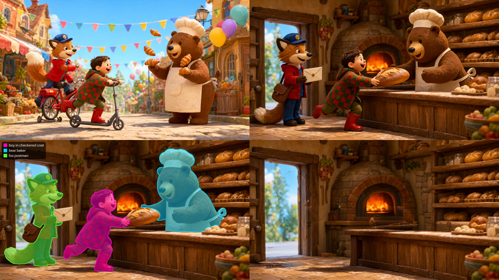

# Session · Leo in the Village (storybook making-of)

**[⬇ leo-in-the-village.zip](leo-in-the-village.zip)**

**EN** — The [Nomad Studio](https://github.com/nomadstudioapp/NomadStudio) Session from the interactive storybook making-of, in five steps: a master picture with the whole cast (a boy in a checkered coat, a bear baker and a fox postman at a village festival) from a one-line idea with **Create · Assist** and **Qwen Image 2.1** → page one inside the bakery with **Edit Qwen 2.1** (same style and characters, a brand-new scene) → **Upscale x2** → one mask and one cutout per character with **Smart Selection** (`boy in checkered coat, bear baker, fox postman`) → the empty bakery with **Smart Object Removal** (the same names plus what they hold). Cutouts + clean background = layers for an interactive page. Needs Nomad Studio 1.1.3 or later; the zip has every image, prompt and seed — import it (Session → Import) and branch from any step.

**ES** — La Session de [Nomad Studio](https://github.com/nomadstudioapp/NomadStudio) del making-of del cuento interactivo, en cinco pasos: una lámina maestra con todos los personajes (un niño con abrigo de cuadros, una osa panadera y un zorro cartero en una fiesta del pueblo) a partir de una idea de una línea con **Create · Assist** y **Qwen Image 2.1** → la página uno dentro de la panadería con **Edit Qwen 2.1** (mismo estilo y personajes, escena nueva) → **Upscale x2** → una máscara y un recorte por personaje con **Selección inteligente** (`boy in checkered coat, bear baker, fox postman`) → la panadería vacía con **Borrado inteligente de objetos** (los mismos nombres más lo que llevan en la mano). Recortes + fondo limpio = capas para una página interactiva. Necesita Nomad Studio 1.1.3 o posterior; el zip trae todas las imágenes, prompts y semillas: impórtalo (Session → Import) y sigue desde cualquier paso.

**ZH** — 互动绘本幕后制作中使用的 [Nomad Studio](https://github.com/nomadstudioapp/NomadStudio) Session，共五步：用 **Create · Assist** 和 **Qwen Image 2.1** 从一句话创意生成包含全部角色的主图（穿格子外套的男孩、熊面包师和狐狸邮差在村庄节日中）→ 用 **Edit Qwen 2.1** 生成面包店内的第一页（相同风格和角色，全新场景）→ **2 倍放大** → 用 **智能选区**（`boy in checkered coat, bear baker, fox postman`）为每个角色生成一张遮罩和一张抠图 → 用 **智能移除物体**（同样的名称加上他们手中的物品）得到空无一人的面包店。抠图 + 干净背景 = 可用于互动页面的图层。需要 Nomad Studio 1.1.3 或更高版本；zip 中包含所有图片、提示词和种子——导入即可（Session → Import），从任意一步继续。

**KO** — 인터랙티브 동화책 메이킹에 사용한 [Nomad Studio](https://github.com/nomadstudioapp/NomadStudio) Session, 다섯 단계: **Create · Assist**와 **Qwen Image 2.1**로 한 줄 아이디어에서 모든 캐릭터가 등장하는 마스터 이미지(마을 축제의 체크무늬 코트를 입은 소년, 곰 제빵사, 여우 우체부) 생성 → **Edit Qwen 2.1**로 빵집 안의 첫 페이지(같은 스타일과 캐릭터, 완전히 새로운 장면) → **2배 업스케일** → **스마트 선택**(`boy in checkered coat, bear baker, fox postman`)으로 캐릭터마다 마스크와 컷아웃 하나씩 → **스마트 객체 제거**(같은 이름과 손에 든 물건)로 텅 빈 빵집. 컷아웃 + 깨끗한 배경 = 인터랙티브 페이지용 레이어. Nomad Studio 1.1.3 이상이 필요하며, zip에 모든 이미지, 프롬프트, 시드가 들어 있어 가져오기(Session → Import) 후 어느 단계에서든 이어서 작업할 수 있습니다.
