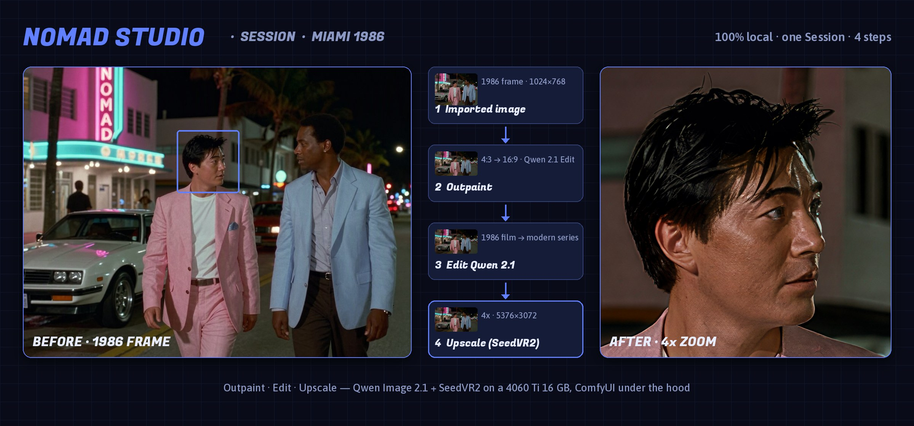

# Session · Miami 1986

**[⬇ miami-1986.zip](miami-1986.zip)**

**EN** — One [Nomad Studio](https://github.com/nomadstudioapp/NomadStudio) Session: a 1986-style TV frame → outpaint 16:9 → Edit Qwen 2.1 → SeedVR2 4x upscale. The zip has every image, prompt and seed.

**ES** — Una Session de [Nomad Studio](https://github.com/nomadstudioapp/NomadStudio): un fotograma al estilo de 1986 → outpaint 16:9 → Edit Qwen 2.1 → upscale 4x con SeedVR2. El zip trae todas las imágenes, prompts y semillas.

**ZH** — 一个 [Nomad Studio](https://github.com/nomadstudioapp/NomadStudio) Session：1986 年风格的电视画面 → 外扩到 16:9 → Edit Qwen 2.1 → SeedVR2 放大 4 倍。zip 中包含所有图片、提示词和种子。

**KO** — [Nomad Studio](https://github.com/nomadstudioapp/NomadStudio) Session 하나: 1986년 스타일 TV 장면 → 16:9 아웃페인트 → Edit Qwen 2.1 → SeedVR2 4배 업스케일. zip에 모든 이미지, 프롬프트, 시드가 들어 있습니다.
