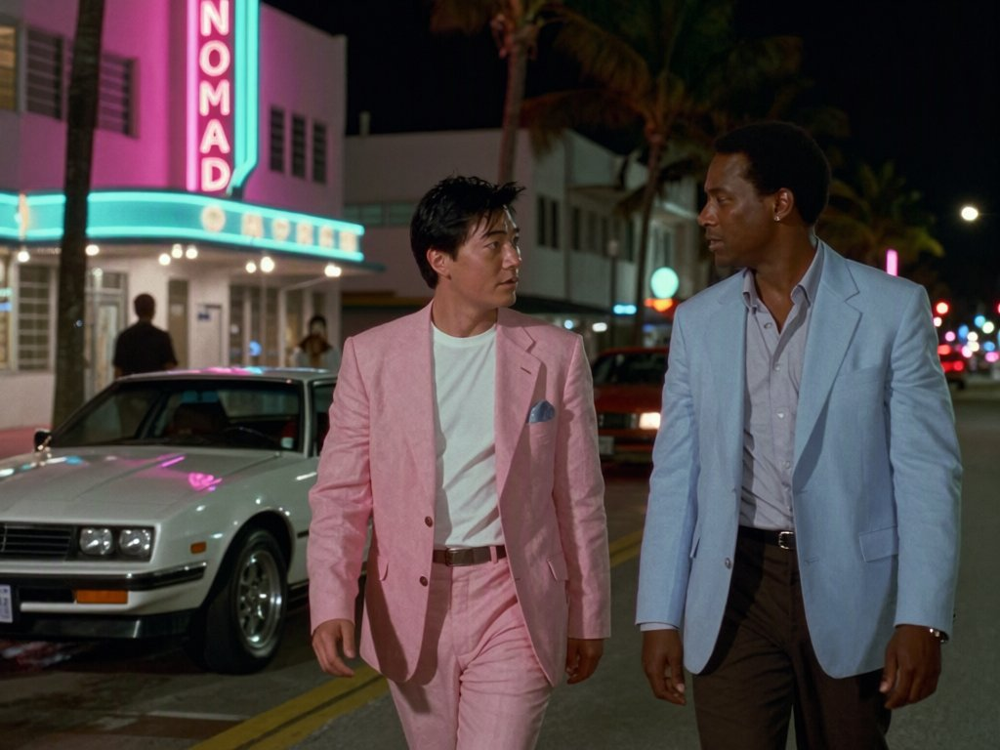
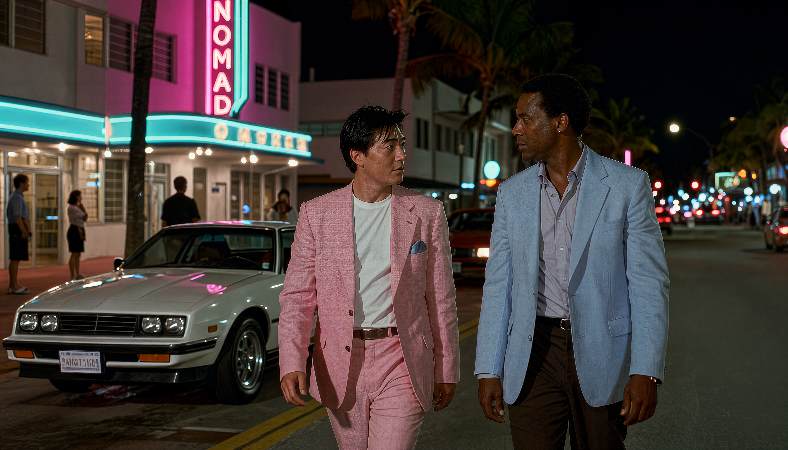

# Miami 1986

_Created: 2026-10-15T16:23:52.326298+00:00_

## Models required

_No model files detected._

## Steps

### 1. Imported image · import

### 2. Outpaint · refine

**Prompt:** Replace the black area with a continuation of the image: more of the same Ocean Drive street at night, the whole white sports car on the left, art deco buildings with pink and turquoise neon, palm trees, people on the sidewalk, in the same 1980s film look and lighting.

**Params:** seed `-1`, `11.height` = `768`, `11.width` = `1344`, `13.prompt` = `Replace the black area with a continuation of the image: more of the same Ocean Drive street at night, the whole white sports car on the left, art deco buildings with pink and turquoise neon, palm trees, people on the sidewalk, in the same 1980s film look and lighting.`, `14.prompt` = ``, `15.cfg` = `1`, `15.seed` = `2112592121`, `15.steps` = `25`, `3.clip_name` = `qwen3vl_8b_int8_convrot.safetensors`, `6.unet_name` = `qwen_image_2.1_int8_convrot.safetensors`, `_preprocess.offset_x` = `0`, `_preprocess.offset_y` = `0`, `_preprocess.position` = `center`, `_preprocess.scale` = `100`

### 3. Edit Qwen 2.1 · refine

**Prompt:** Turn this into a still from a modern high-end TV series shot on a digital cinema camera: sharp focus, fine detail, natural skin texture, clean image without film grain, rich contrast and deep blacks, glowing neon. Keep the same two men, their faces, hair and clothes, the white car, the NOMAD neon sign, the street and the composition exactly as they are.

**Params:** seed `-1`, `13.prompt` = `Turn this into a still from a modern high-end TV series shot on a digital cinema camera: sharp focus, fine detail, natural skin texture, clean image without film grain, rich contrast and deep blacks, glowing neon. Keep the same two men, their faces, hair and clothes, the white car, the NOMAD neon sign, the street and the composition exactly as they are.`, `15.cfg` = `1`, `15.seed` = `1805467100`, `15.steps` = `25`, `3.clip_name` = `qwen3vl_8b_int8_convrot.safetensors`, `6.unet_name` = `qwen_image_2.1_int8_convrot.safetensors`

### 4. Upscale (SeedVR2) · refine

**Params:** seed `-1`, `66:52.unet_name` = `seedvr2_3b_int8_convrot.safetensors`, `66:54.seed` = `6193501`, `66:57.resize_type.multiplier` = `4`

