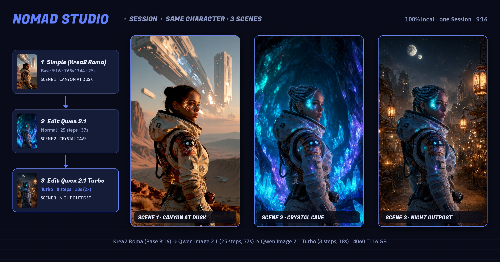

# Session · Same Character, 3 Scenes (9:16)

**[⬇ same-character-3-scenes.zip](same-character-3-scenes.zip)**

**EN** — One [Nomad Studio](https://github.com/nomadstudioapp/NomadStudio) Session in vertical 9:16 (`768×1344`): base sci-fi nomad explorer generated with **Krea2 Roma** (25s) → scene swap + relight into a bioluminescent crystal cave with **Edit Qwen 2.1** (25 steps, 37s) → scene swap into a night outpost market under twin moons with **Edit Qwen 2.1 Turbo** (8 steps, 18s — 2× faster). The zip has every image, prompt and seed — import it straight into Nomad Studio (Session → Import) and branch from any step.

**ES** — Una Session de [Nomad Studio](https://github.com/nomadstudioapp/NomadStudio) en formato vertical 9:16 (`768×1344`): exploradora sci-fi base generada con **Krea2 Roma** (25s) → cambio de escena y re-iluminación en una cueva de cristal bioluminiscente con **Edit Qwen 2.1** (25 steps, 37s) → cambio de escena a un mercado nómada nocturno bajo dos lunas con **Edit Qwen 2.1 Turbo** (8 steps, 18s — el doble de rápido). El zip trae todas las imágenes, prompts y semillas: impórtalo directamente en Nomad Studio (Session → Import) y sigue desde cualquier paso.

**ZH** — 一个 9:16 竖屏（`768×1344`）的 [Nomad Studio](https://github.com/nomadstudioapp/NomadStudio) Session：使用 **Krea2 Roma** 生成科幻探险家基础角色（25 秒）→ 使用 **Edit Qwen 2.1**（25 步，37 秒）切换到发光水晶洞穴并重打光 → 使用 **Edit Qwen 2.1 Turbo**（8 步，18 秒，速度提升 2 倍）切换到双月下的夜间前哨市集。zip 中包含所有图片、提示词和种子——可直接导入 Nomad Studio（Session → Import），从任意一步继续。

**KO** — 9:16 세로형(`768×1344`) [Nomad Studio](https://github.com/nomadstudioapp/NomadStudio) Session: **Krea2 Roma**로 생성한 SF 탐험가 기본 캐릭터(25초) → **Edit Qwen 2.1**(25 스텝, 37초)로 생물발광 수정 동굴 장면 전환 및 리라이팅 → **Edit Qwen 2.1 Turbo**(8 스텝, 18초 — 2배 빠른 속도)로 두 개의 달이 뜬 야간 전초기지 시장으로 장면 전환. zip에 모든 이미지, 프롬프트, 시드가 들어 있으며, Nomad Studio에 바로 가져와(Session → Import) 어느 단계에서든 이어서 작업할 수 있습니다.
